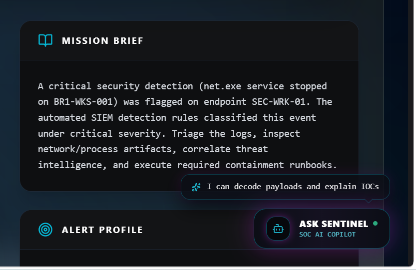
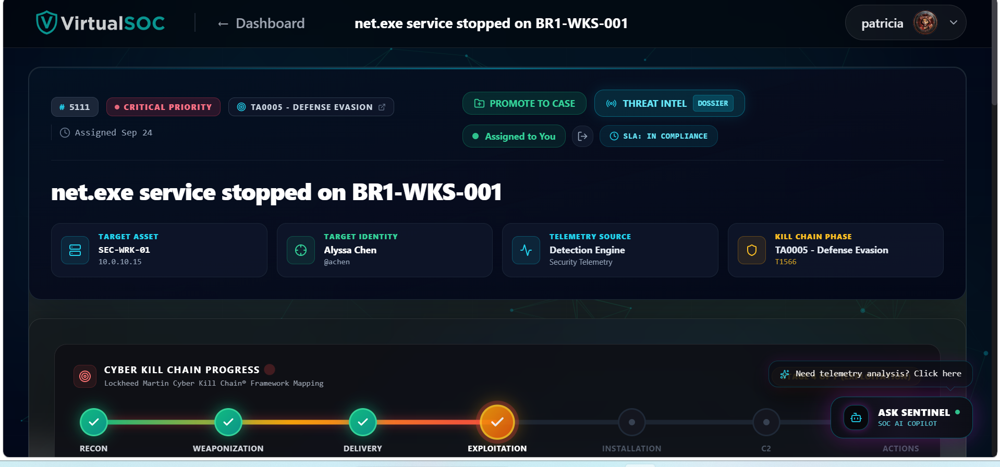
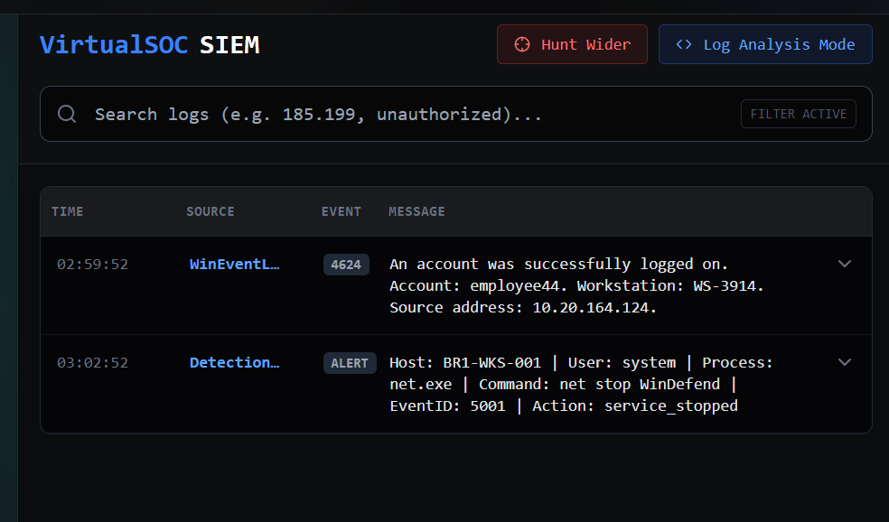

# SOC Incident Response Case Study: Lateral Movement & Defense Evasion

## Overview
This repository documents an end-to-end Tier 1/Tier 2 Security Operations Center (SOC) investigation conducted within a simulated enterprise environment (**VirtualSOC**). The investigation began with a critical alert indicating that Microsoft Defender Antivirus real-time protection had been stopped on an internal workstation (`BR1-WKS-001`), uncovering a multi-stage lateral movement and privilege escalation attack across segmented network subnets.

* **Alert ID:** `#5111` - `net.exe service stopped on BR1-WKS-001`
* **Primary Telemetry:** Windows Defender Operational (`Event ID 5001`) & Windows Security (`Event ID 4624`)
* **Attack Category:** Network Intrusion / Lateral Movement
* **Final Verdict:** **True Positive**

### Mission Brief & Alert Triage

---

## Documentation Structure
Explore the complete incident response documentation inside the `docs/` directory:

* [**01. Project Overview**](docs/project-overview.md) - Incident scope, network topology, and investigation objectives.
* [**02. Attack Investigation & Reconstruction**](docs/attack-investigation-and-reconstruction.md) - Chronological timeline analysis, log correlation, and privilege escalation breakdown.
* [**03. MITRE ATT&CK Mapping**](docs/mitre-attack-mapping.md) - Adversary tactics, techniques, and sub-techniques observed during the intrusion.
* [**04. Executive Report**](docs/executive-report.md) - Non-technical leadership summary detailing business impact and containment status.
* [**05. Incident Summary**](docs/incident-summary.md) - Technical ticket closure notes and complete Indicators of Compromise (IoCs).
* [**06. Containment & Response**](docs/containment-and-response.md) - Immediate host isolation, credential invalidation, and post-containment triage steps.
* [**07. Lessons Learned**](docs/lessons-larned.md) - Root cause analysis and long-term defensive hardening recommendations.

---

## Visual Evidence & Log Correlation

### SIEM Alert & Cyber Kill Chain Dashboard
The alert dashboard mapped the intrusion into the **Exploitation** phase under **Defense Evasion (`TA0005`)**, monitored centrally from SIEM host `SEC-WRK-01` (`10.0.10.15`):

### Correlated Windows Event Logs
Correlating authentication logs with defense telemetry revealed a 3-minute window between remote account authentication and `SYSTEM`-level service termination:

---
